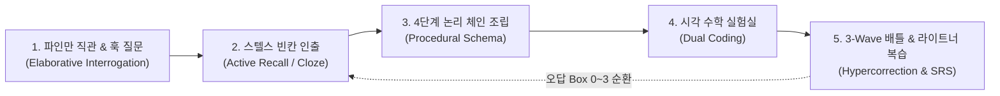

# 📘 LOGIC PRISM 커리큘럼 및 인지학습 설계 가이드 (`CURRICULUM_AND_LOGIC.md`)

> **대상 과정**: 2022 개정 교육과정 고등학교 1학년 **공통수학1 (1학기 중간고사 반학기 범위)**  
> **단원 범위**: **Ⅰ. 다항식** 전 단원 (`Ch 1 ~ Ch 3`) + **Ⅱ. 방정식과 부등식** 중 복소수 ~ 이차함수의 최대·최소 (`Ch 4 ~ Ch 5`)  
> **구성 규모**: 5개 중단원 · 15개 마스터 스테이지 · 45개 스텔스 공식 · 15개 4단계 논리 체인 · 4종 시각 수학 실험실 · 105개 실전 배틀 문항

---

## 1. 교육공학적 인지 학습 설계 (Cognitive Learning Design)

고등학교 수학에서 학생들이 가장 흔히 겪는 실패 원인은 **"공식을 눈으로 읽어 익숙해진 상태를 이해했다고 착각하는 것(Illusion of Competence)"** 과 **"조건에서 결론으로 넘어가는 중간 논리 고리의 단절"** 입니다. **LOGIC PRISM**은 인지심리학과 수학교육학의 5가지 검증된 원리를 소프트웨어 인터랙션으로 구현했습니다.

### 1.1 파인만 직관 기법과 정교화 질문 (Feynman Intuition & Elaborative Interrogation)
- 각 스테이지는 정의를 나열하기 전에 **"왜?"** 를 묻는 `hookQuestion`으로 시작합니다.
- 공식을 압축된 결과물이 아니라 **문제를 가장 적은 연산으로 해결하기 위해 발명된 도구**로 재해석(`intuition`, `keyInsight`)하여 개념 스키마를 형성합니다.

### 1.2 능동적 인출과 스텔스 클로즈 효과 (Active Recall & Cloze Generation)
- 45개 모든 필수 공식은 전체 수식(`latex`)과 함께 핵심 항을 `\boxed{?}` 블록으로 가린 **스텔스 수식(`clozeLatex`)** 을 보유합니다.
- 학습자가 빈칸의 부호·계수·차수를 머릿속에서 먼저 생성(Generation Effect)한 뒤 클릭하여 검증함으로써 단순 재인(Recognition)보다 훨씬 강력한 장기 기억 인출 경로를 만듭니다.

### 1.3 논리 체인 조립을 통한 절차적 추론 강화 (Logic Chaining)
- 내신 서술형과 고난도 문항은 결국 **4단계 내외의 필연적 동치 변형 및 대입 추론**으로 귀결됩니다.
- **4단계 논리 체인 조립 퍼즐**은 증명·풀이 과정을 `Step 1 (출발 조건/정의) → Step 2 (핵심 식 변형) → Step 3 (대칭/소거/판별 적용) → Step 4 (최종 결론 및 예외 검증)` 으로 구조화하고, 학습자가 섞인 블록을 직접 순서대로 맞추며 각 단계의 정당화 근거(`reason`)를 확인하게 합니다.

### 1.4 이중 부호화 이론과 동적 시각화 (Dual Coding & Dynamic Manipulation)
- 대수적 기호 표상과 기하학적 시각 표상을 실시간으로 연결하기 위해 **4종의 HiDPI 캔버스 실험실**을 설계했습니다.
- 슬라이더를 움직이는 즉시 넓이 블록, 조립제법 계수 표, 복소평면 회전 벡터, 포물선 대칭축과 최대·최소 지점이 연속적으로 변하며 직관과 수식을 하나로 묶어줍니다.

### 1.5 과교정 효과와 라이트너 간격 반복 (Hypercorrection & Leitner Spaced Repetition)
- **3-Wave 점진적 인지 부하 설계**:
  - **Wave 1 (O/X 개념 함정 브레이커 · 3제)**: 명제의 참/거짓 판별을 통해 미묘한 전제 조건(실계수, $a \neq 0$, 등호 포함 여부 등)을 정밀 타격합니다.
  - **Wave 2 (개념·공식 변형 드릴 · 3제)**: 표준 내신 빈출 유형의 정확한 연산과 구조 적용을 훈련합니다.
  - **Wave 3 (내신 실전 보스전 · 1제)**: 두 개 이상의 개념이 결합된 심화 문항으로 단원 마스터 여부를 최종 검증합니다.
- **과교정(Hypercorrection) 해설**: 확신을 가지고 풀었으나 틀렸을 때 즉각적이고 논리적인 교정 피드백을 제공하면 기억 정착률이 극대화됩니다. 모든 문항 직후 단계별 수식 해설이 즉시 노출됩니다.
- **Leitner Box 0~3 오답 관리**:
  - 오답 발생 시 즉시 `Box 0 (긴급 복습)` 에 편입됩니다.
  - 복습 배틀에서 연속 정답을 맞힐 때마다 `Box 0 → Box 1 → Box 2 → Box 3 (완전 졸업)` 으로 승급하며, 다시 틀리면 `Box 0`으로 강등되어 약점이 완전히 사라질 때까지 추적합니다.

---

## 2. 전 단원 커리큘럼 및 핵심 논리 유도 매핑 (5 Chapters · 15 Stages)

### Ⅰ. 다항식 (`Chapters 1 ~ 3` · `STAGE 01 ~ 09`)

#### Chapter I-1. 다항식의 연산 (`ch1` · 연계 실험실: `poly-sim`)

| 스테이지 | 제목 | 핵심 공식 및 대수 구조 | 4단계 논리 체인 유도 핵심 (`Step 1 → 4`) |
| :--- | :--- | :--- | :--- |
| **STAGE 01** | 다항식의 정리와 덧셈·뺄셈 | 기준 문자에 대한 내림차순 정리, 상수항 재정의, 동류항 결합 | 기준 문자 설정(나머지 문자는 상수 취급) → 차수별 항 분류 → 동류항 계수 묶기 → 내림차순 표준 형태 완성 |
| **STAGE 02** | 곱셈공식과 곱셈공식의 변형 | $(a+b)^2$, $(a+b)^3$, $a^3 \pm b^3$, $a^2+b^2+c^2 = (a+b+c)^2 - 2(ab+bc+ca)$ | 전개식의 대칭 구조 파악 → 구하려는 거듭제곱 합 분리 → 기본 대칭식($a+b, ab$)으로 이항 정리 → 부호 및 계수 정합성 검증 |
| **STAGE 03** | 다항식의 나눗셈과 $A = BQ + R$ | $A = BQ + R$ ($\deg(R) < \deg(B)$ 또는 $R=0$), 제수 변형 시 몫·나머지 변화 | 나눗셈 결과를 항등식 $A=BQ+R$로 표현 → 나머지 차수 조건($\deg(R)<\deg(B)$) 확인 → 나누는 식 변형 시 식 재묶기 → 차수 조건에 맞게 진짜 몫과 나머지 확정 |

#### Chapter I-2. 항등식과 나머지정리 (`ch2` · 연계 실험실: `synthetic-div`)

| 스테이지 | 제목 | 핵심 공식 및 대수 구조 | 4단계 논리 체인 유도 핵심 (`Step 1 → 4`) |
| :--- | :--- | :--- | :--- |
| **STAGE 04** | 항등식의 성질과 미정계수법 | $ax^2+bx+c=0$ 항등식 조건, 계수비교법 vs 수치대입법 선택 기준 | 주어진 등식이 $x$에 대한 항등식임을 확인 → 식의 형태(전개 용이 vs 인수 형태) 분석 → 최적의 수치 대입 또는 동류항 계수 비교 → 미정계수 연립 확정 |
| **STAGE 05** | 나머지정리와 인수정리 | $R = P(\alpha)$, $P(\alpha)=0 \iff (x-\alpha)$ 인수, 이차식 나눗셈 나머지 $ax+b$ | $P(x) = (x-\alpha)(x-\beta)Q(x) + ax + b$ 설정 → $Q(x)$를 증발시키는 $x=\alpha, \beta$ 대입 → $a, b$ 연립방정식 도출 → 일차 이하 나머지 $R(x)$ 완성 |
| **STAGE 06** | 조립제법과 일차식 계수 함정 | $x-\alpha$ 조립제법 알고리즘, $ax+b$ 나눗셈 몫 $\frac{1}{a}Q(x)$ 보정 원리 | $P(x) = (x + \frac{b}{a})Q_1(x) + R$ 조립제법 수행 → 일차 인수를 $a(x + \frac{b}{a}) = ax+b$로 재결합 → $P(x) = (ax+b) \cdot \frac{1}{a}Q_1(x) + R$ 유도 → 몫은 $\frac{1}{a}$배, 나머지 $R$은 불변 확정 |

#### Chapter I-3. 인수분해 (`ch3` · 연계 실험실: `poly-sim`)

| 스테이지 | 제목 | 핵심 공식 및 대수 구조 | 4단계 논리 체인 유도 핵심 (`Step 1 → 4`) |
| :--- | :--- | :--- | :--- |
| **STAGE 07** | 핵심 인수분해 공식과 세제곱 대칭식 | $a^3 \pm b^3$, $a^3+b^3+c^3-3abc = \frac{1}{2}(a+b+c)\{(a-b)^2+(b-c)^2+(c-a)^2\}$ | 3문자 세제곱 인수분해 공식 적용 → 이차 인수를 $\frac{1}{2}$로 묶어 완전제곱식의 합으로 변형 → $a^3+b^3+c^3=3abc$ 조건 해석 → $a+b+c=0$ 또는 $a=b=c$ 도출 |
| **STAGE 08** | 복잡한 식의 인수분해 전략 | 공통부분 치환, 복이차식($x^4+ax^2+b \to A^2-B^2$), 최저차 문자 내림차순 | 식의 구조 진단(공통부분/복이차/다문자) → 최저차 문자 기준 내림차순 정리 또는 완전제곱 변형 → 상수항 인수분해 후 공통인수 추출 → 더 이상 분해되지 않을 때까지 최종 인수분해 |
| **STAGE 09** | 인수정리를 이용한 고차식의 인수분해 | 유리근 후보 $\pm \frac{\text{상수항의 약수}}{\text{최고차항 계수의 약수}}$, 연쇄 조립제법 | $P(\alpha)=0$을 만족하는 약수 후보 $\alpha$ 탐색 → 인수정리로 일차 인수 $(x-\alpha)$ 확보 → 조립제법으로 몫 다항식 차수 축소 → 남은 이차/고차 몫을 끝까지 인수분해 |

---

### Ⅱ. 방정식과 부등식 — 중간고사 범위 (`Chapters 4 ~ 5` · `STAGE 10 ~ 15`)

#### Chapter II-1. 복소수와 이차방정식 (`ch4` · 연계 실험실: `complex-plane`)

| 스테이지 | 제목 | 핵심 공식 및 대수 구조 | 4단계 논리 체인 유도 핵심 (`Step 1 → 4`) |
| :--- | :--- | :--- | :--- |
| **STAGE 10** | 허수단위 $i$와 복소수의 연산·켤레복소수 | $i^2=-1$, $i^{4k+r}$ 4주기 순환, $\overline{a+bi}=a-bi$, $z+\overline{z}=2a$, $z\overline{z}=a^2+b^2$ | 복소수를 $a+bi$ ($a,b$는 실수) 표준형으로 정리 → 복소수 상등 조건 또는 분모의 켤레복소수 곱셈 적용 → $i^n$의 연속된 4개 항 합이 $0$임을 이용해 지수 축약 → 실수부와 허수부 최종 분리 |
| **STAGE 11** | 음수의 제곱근 성질과 이차방정식의 판별식 | $\sqrt{a}\sqrt{b}=-\sqrt{ab}$ ($a<0, b<0$), $\frac{\sqrt{a}}{\sqrt{b}}=-\sqrt{\frac{a}{b}}$ ($a>0, b<0$), 판별식 $D=b^2-4ac$ | 음수의 제곱근 부호 조건으로부터 문자들의 부호 범위 판정($0$ 포함 예외 체크) → 절댓값/제곱근 식 간단히 정리 → 실계수 이차방정식 확인 후 판별식 $D$ 부호 설정 → 실근/중근/서로 다른 두 허근 조건 확정 |
| **STAGE 12** | 이차방정식의 근과 계수의 관계 | $\alpha+\beta = -\frac{b}{a}$, $\alpha\beta = \frac{c}{a}$, $(\alpha-\beta)^2 = (\alpha+\beta)^2 - 4\alpha\beta$, 켤레근 성질 | $ax^2+bx+c = a(x-\alpha)(x-\beta)$ 항등식 전개 → 계수 비교로 합·곱 공식 도출 → 주어진 대칭식을 $\alpha+\beta, \alpha\beta$로 변환(또는 켤레근 계수 조건 확인) → 미정계수 및 식의 값 산출 |

#### Chapter II-2. 이차방정식과 이차함수 (`ch5` · 연계 실험실: `quadratic-explorer`)

| 스테이지 | 제목 | 핵심 공식 및 대수 구조 | 4단계 논리 체인 유도 핵심 (`Step 1 → 4`) |
| :--- | :--- | :--- | :--- |
| **STAGE 13** | 이차함수의 그래프와 $x$축의 위치 관계 | 그래프와 $x$축 교점의 $x$좌표 $\iff ax^2+bx+c=0$의 실근, $D>0 / D=0 / D<0$ | 기하학적 교점 조건($x$축과 두 점/접함/만나지 않음) 확인 → 방정식 $ax^2+bx+c=0$의 실근 개수 문제로 번역 → 최고차항 계수 $a \neq 0$ 확인 후 판별식 $D$ 부등식 작성 → 해의 범위 확정 |
| **STAGE 14** | 이차함수의 그래프와 직선의 위치 관계 | 연립방정식 $ax^2+(b-m)x+(c-n)=0$, 차함수 $h(x)=f(x)-g(x)$의 판별식 $D$ | 포물선 $y=ax^2+bx+c$와 직선 $y=mx+n$ 연립 → 이항하여 차방정식 $ax^2+(b-m)x+(c-n)=0$ 구성 → 위치 관계(서로 다른 두 점/접선/비교점)에 대응하는 $D$ 조건 적용 → 기울기 $m$ 또는 절편 $n$ 결정 |
| **STAGE 15** | 이차함수의 최대·최소와 제한된 범위 | 표준형 $y=a(x-p)^2+q$, 제한 구간 $[\alpha, \beta]$와 대칭축 $x=p$의 3가지 위치 케이스 | 완전제곱식으로 변형하여 아래/위로 볼록($a$의 부호)과 대칭축 $x=p$ 파악 → 제한된 범위 $\alpha \le x \le \beta$ 내부에 $p$가 속하는지 판별 → 축 포함 시 꼭짓점과 먼 양 끝점 비교 / 축 이탈 시 양 끝점 $f(\alpha), f(\beta)$ 비교 → 최댓값 $M$·최솟값 $m$ 확정 |

---

## 3. 고1 내신 빈출 함정 분류 체계 (Exam Trap Taxonomy)

학교 내신 시험은 개념을 대충 외운 학생을 걸러내기 위해 **전제 조건·등호·계수 보정**에서 정교한 함정을 설계합니다. **LOGIC PRISM**의 `trapAlert`, `oxQuizzes`, `problems`는 아래 12대 내신 함정을 빈틈없이 훈련시킵니다.

| 분류 코드 | 단원 | 함정 유형 | 오답 패턴 (학생의 흔한 실수) | 올바른 논리 교정 (LOGIC PRISM 처방) |
| :--- | :--- | :--- | :--- | :--- |
| **TRAP-01** | `STAGE 01` | 다문자 다항식의 차수와 상수항 | $x$에 대한 다항식에서 $y^3$ 항을 보고 3차항으로 착각 | 지정된 기준 문자($x$) 외의 모든 문자($y, z$)는 **숫자(상수)** 취급하며, $x$가 없는 모든 항의 합 전체가 상수항이다. |
| **TRAP-02** | `STAGE 03` | 다항식 나눗셈의 차수 조건 | $P(x)=B(x)Q(x)+R(x)$ 꼴만 맞으면 무조건 $R(x)$를 나머지라 단정 | 반드시 **$\deg(R) < \deg(B)$ (또는 $R=0$)** 여야 한다. 차수가 크거나 같으면 $B(x)$로 한 번 더 나누어 몫에 합산해야 한다. |
| **TRAP-03** | `STAGE 05` | 고차식으로 나눈 나머지 설정 | 이차식 $(x-1)(x-2)$로 나눈 나머지를 상수 $R$로 설정 | $n$차식으로 나눈 나머지는 **$(n-1)$차 이하의 다항식**이므로 이차식일 때 $ax+b$, 삼차식일 때 $ax^2+bx+c$로 두어야 한다. |
| **TRAP-04** | `STAGE 06` | 조립제법 $ax+b$ 몫의 계수 함정 | $2x-2$로 나눌 때 $x=1$ 조립제법 결과를 그대로 몫이라 답함 | 조립제법은 항상 최고차항 계수가 $1$인 $(x-\alpha)$ 기준이다. $ax+b$로 나눈 진짜 몫은 **조립제법 몫을 $a$로 나눈 $\frac{1}{a}Q(x)$** 이며 나머지는 같다. |
| **TRAP-05** | `STAGE 07` | $a^3+b^3+c^3=3abc$ 동치 해석 | 세 양수 $a,b,c$ 조건이 없는데도 무조건 $a=b=c$만 적용 | $a^3+b^3+c^3-3abc=0 \iff$ **$a+b+c=0$ 또는 $a=b=c$** 두 가지 경우를 모두 검토해야 한다 (삼각형 세 변의 길이 조건일 때만 $a+b+c>0$이므로 정삼각형 확정). |
| **TRAP-06** | `STAGE 10` | 복소수의 대소 비교 및 제곱 실수 조건 | $3i > i$가 참이라고 생각하거나, $z^2$이 실수이면 $z$는 실수라 단정 | 허수는 수직선 위에 없으므로 **대소 비교($>, <$) 자체가 정의되지 않는다.** 또한 $z^2$이 음의 실수가 되는 경우는 **$z$가 순허수**일 때이다. |
| **TRAP-07** | `STAGE 11` | 음수의 제곱근 역방향 추론 ($0$ 예외) | $\sqrt{a}\sqrt{b}=-\sqrt{ab}$ 이면 무조건 $a<0, b<0$만 생각 | 명제의 역 방향에서 등식이 성립할 조건을 구할 때는 **$a=0$ 또는 $b=0$이어도 $0=0$으로 참**이므로 $a \le 0, b \le 0$ (또는 분수꼴에서 분자 $a=0$ 포함)을 반드시 챙겨야 한다. |
| **TRAP-08** | `STAGE 11` | 허계수 이차방정식에서의 판별식 오용 | $x^2 + 2ix - 1 = 0$ 에서 $D = (2i)^2 - 4(1)(-1) = 0$ 이므로 서로 다른 실근/허근 판정에 그대로 사용 | $D > 0, D < 0$으로 **실근과 허근의 개수를 판별하는 것은 계수 $a, b, c$가 모두 실수일 때만** 성립한다. (단, 중근 조건 $D=0$만 복소계수에서도 성립). |
| **TRAP-09** | `STAGE 12` | 켤레근 성질의 계수 전제 조건 | 한 근이 $1+\sqrt{2}$이면 계수 조건 확인 없이 다른 근을 $1-\sqrt{2}$로 확정 | 무리수 켤레근($p \pm q\sqrt{m}$)은 **모든 계수가 유리수**일 때만, 복소수 켤레근($p \pm qi$)은 **모든 계수가 실수**일 때만 보장된다. |
| **TRAP-10** | `STAGE 13` | '이차방정식/이차함수' 문구와 최고차항 미지수 | $kx^2 - 2kx + 1 = 0$이 실근을 가질 조건에서 $k=0$을 포함시킴 | 문제에 **'이차방정식'** 또는 **'이차함수'** 라고 명시되어 있으면 판별식 이전에 반드시 **최고차항 계수 $k \neq 0$** 조건을 먼저 걸어야 한다. |
| **TRAP-11** | `STAGE 14` | 직선과 포물선의 위치 관계와 $a$의 부호 | "포물선이 항상 직선보다 위쪽에 있다"를 무조건 $D > 0$으로 착각 | 포물선이 직선과 **만나지 않아야** 항상 위쪽에 있을 수 있으므로 **$a > 0$ 이고 교점 방정식의 판별식 $D < 0$** 이어야 한다. |
| **TRAP-12** | `STAGE 15` | 제한된 범위에서의 이차함수 최대·최소 | 구간 $[1, 4]$가 주어졌는데 대칭축 $x=-1$인 꼭짓점의 $y$값을 최솟값으로 답함 | 제한된 범위 $\alpha \le x \le \beta$ 밖의 꼭짓점은 그래프에 존재하지 않는 유령 점이다! 반드시 **대칭축 $x=p$가 구간에 포함되는지 먼저 확인**하고, 벗어나면 양 끝점 $f(\alpha), f(\beta)$만 비교한다. |

---

## 4. 품질 보증 및 자동 검증 아키텍처 (Verification Pipeline)

교육용 플랫폼에서 **단 하나의 수식 오타나 잘못된 정답 인덱스도 학습자의 신뢰를 무너뜨릴 수 있습니다.** 이를 원천 차단하기 위해 2중 자동 검증 게이트를 운영합니다.

1. **정적 수식·스키마·수학적 무결성 검증 (`scripts/validate-curriculum.mjs`)**
   - 5개 챕터, 15개 스테이지의 필수 필드 누락 여부 전수 검사
   - 45개 공식의 순수 LaTeX 포맷 및 `\boxed` 클로즈 문법 검사
   - 모든 한글 설명·문항·선지·해설 내 `$...$` 수식 구분자의 짝 맞음(Balanced Delimiters) 검사
   - 전체 O/X 문항(45제) 및 객관식 문항(60제)의 중복 없는 선택지, 유효한 `answerIndex`, 수학적 계산 정합성 검증
2. **실제 브라우저 기반 E2E 검증 (`tests/verify-e2e.mjs`)**
   - 로컬 HTTP 서버 및 헤드리스 브라우저에서 실제 사용자 시나리오 수행
   - 렌더링된 DOM 텍스트(`innerText`)에 치환되지 않은 날것의 `$` 수식 문자열이 0건인지 확인
   - 라이트/다크 테마 전환, 스텔스 빈칸 토글, 4단계 논리 체인 완주, 3-Wave 배틀 7문항 완주 및 라이트너 오답 배지 증가, 4종 시각 실험실 `<canvas>` 픽셀 렌더링, 모바일(`375px`)/데스크톱(`1440px`) 무결성 자동 검증
